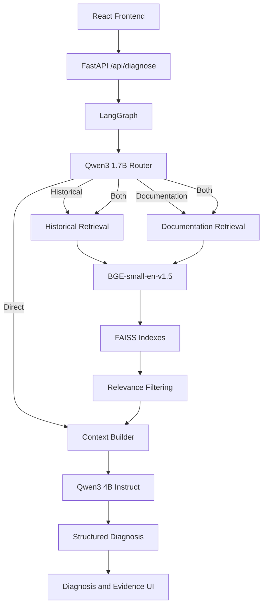

# RAG-Based AI Assistant for IT Incident Diagnosis and Troubleshooting

**IncidentIQ** is a fully local Retrieval-Augmented Generation (RAG) assistant for IT incident descriptions, error messages, short log extracts, and technical questions. It combines synthetic GLPI-inspired historical incidents, curated official documentation, semantic retrieval, and local language models to produce an evidence-grounded diagnosis and troubleshooting steps.

The project is a practical prototype, not a production-ready incident-management replacement. It uses free/open-source local components and is designed to keep diagnostic data on the local machine.

[](https://www.python.org/)
[](https://fastapi.tiangolo.com/)
[](https://www.langchain.com/langgraph)
[](https://github.com/facebookresearch/faiss)
[](https://react.dev/)
[](https://www.typescriptlang.org/)

## Motivation

IT teams accumulate solved incidents in ticketing platforms such as GLPI, while technicians also depend on official product documentation. Searching these sources separately can slow diagnosis. This prototype demonstrates how RAG can combine similar historical cases and technical documentation before a local LLM generates a troubleshooting response.

No internal Condor Electronics ticket data was used. The historical corpus is synthetic and GLPI-inspired.

## Key Features

- Incident, error, log, and technical-question input
- Qwen3 1.7B routing between `historical`, `documentation`, `both`, and `direct`
- BGE semantic embeddings and separate FAISS indexes
- Similarity-based relevance filtering
- LangGraph workflow orchestration
- Structured Pydantic diagnosis output
- Historical ticket evidence with causes and resolutions
- Official documentation evidence with source links
- FastAPI backend and responsive React frontend
- Fully local Ollama inference

## Architecture



## How It Works

1. The user submits an incident, error, log extract, or technical question.
2. Qwen3 1.7B selects the appropriate knowledge route.
3. The router creates concise retrieval queries when retrieval is needed.
4. BGE-small-en-v1.5 converts each query into a 384-dimensional vector.
5. FAISS searches the historical-incident or documentation index.
6. Relevance thresholds remove weak nearest-neighbor results.
7. Retrieved evidence is formatted into a compact diagnosis context.
8. Qwen3 4B Instruct produces a structured diagnosis.
9. React displays the diagnosis and the actual retrieved evidence separately.

## Routing

| Route           | Use when                                                      |
| --------------- | ------------------------------------------------------------- |
| `historical`    | Similar previously solved incidents are most useful.          |
| `documentation` | Official technical reference is the main source.              |
| `both`          | An incident benefits from historical cases and documentation. |
| `direct`        | Retrieval is unnecessary for a basic technical concept.       |

The router is `qwen3:1.7b`. It does not diagnose incidents or call retrieval itself.

## Knowledge Base

### Synthetic historical incidents

The project contains approximately 75 synthetic GLPI-style tickets in `backend/data/incidents/glpi_incidents.csv`. They include fields such as `ticket_id`, `title`, `description`, `category`, `environment`, `error_message`, `symptoms`, `technician_notes`, `root_cause`, `solution`, `urgency`, `impact`, and `priority`.

Only problem-side fields are embedded:

```text
title, description, category, environment, error_message, symptoms
```

`technician_notes`, `root_cause`, and `solution` remain metadata. They become available as evidence only after a similar ticket has been retrieved, preventing the historical answer from being used as the search input.

### Technical documentation

The local documentation corpus contains 20 focused Markdown documents covering PostgreSQL, Linux/Ubuntu, Docker, HTTP, Nginx, DNS/networking, and Windows. Sources include official PostgreSQL, Ubuntu, Docker, MDN, Nginx, and Microsoft documentation.

The project does not crawl public websites at runtime. The curated documents and `sources.json` manifest are stored locally in `backend/data/docs/`.

## Retrieval

- Model: `BAAI/bge-small-en-v1.5`
- Vector dimension: 384
- Embeddings: normalized with `normalize_embeddings=True`
- Index type: `faiss.IndexFlatIP`
- Index files: `backend/indexes/incident_index.faiss` and `backend/indexes/doc_index.faiss`

Because vectors are normalized, inner product is approximately cosine similarity. FAISS stores vectors and numeric positions; JSON metadata stores the ticket or document information. The same position connects a FAISS result to its metadata entry.

### Relevance filtering

FAISS always returns nearest neighbors, even when the nearest result is not genuinely useful. Retrieval and relevance filtering are therefore separate stages.

| Source               | Threshold |
| -------------------- | --------: |
| Historical incidents |    `0.60` |
| Documentation        |    `0.58` |

These are empirical prototype thresholds selected from the repository's retrieval evaluation queries.

## Local Models

| Role      | Model                           | Runtime |
| --------- | ------------------------------- | ------- |
| Router    | `qwen3:1.7b`                    | Ollama  |
| Diagnosis | `qwen3:4b-instruct-2507-q4_K_M` | Ollama  |

The small model performs simple route selection. The larger model generates the grounded technical diagnosis. This project does not train or fine-tune either model.

## Structured Diagnosis

The final Pydantic output contains:

```text
category
severity
likely_cause
explanation
troubleshooting_steps
```

Documentation URLs and historical evidence are not invented by the LLM. They are returned from the retrieved metadata and displayed separately by the API and frontend.

## Project Structure

```text
it-incident-rag-assistant/
├── backend/
│   ├── app/
│   │   ├── config.py
│   │   ├── graph.py
│   │   ├── main.py
│   │   ├── rag.py
│   │   ├── retrieval.py
│   │   ├── router.py
│   │   └── schemas.py
│   ├── data/
│   │   ├── docs/
│   │   ├── incidents/
│   │   └── processed/
│   ├── indexes/
│   ├── scripts/
│   └── requirements.txt
├── frontend/
│   ├── src/
│   │   ├── components/
│   │   ├── data/
│   │   ├── lib/
│   │   ├── types/
│   │   ├── App.tsx
│   │   └── main.tsx
│   └── package.json
├── tests/
│   ├── final_test_cases.json
│   └── frontend_checklist.md
├── DEMO.md
└── README.md
```

## Installation

Prerequisites:

- Python
- Node.js and npm
- Ollama
- Git

From the repository root on Windows:

```powershell
python -m venv .venv
.\.venv\Scripts\Activate.ps1
cd backend
pip install -r requirements.txt
```

Install the exact local models used by the application:

```powershell
ollama pull qwen3:1.7b
ollama pull qwen3:4b-instruct-2507-q4_K_M
```

## Preparing the Knowledge Base

These are one-time or source-change preparation steps, not commands required at every application startup. Run them from `backend/` with the project environment activated:

```powershell
python scripts\create_incident_dataset.py
python scripts\validate_docs.py
python scripts\prepare_docs.py
python scripts\generate_embeddings.py
python scripts\build_faiss_indexes.py
```

The scripts create the synthetic incident CSV, validate and chunk documentation, generate `.npy` embeddings and metadata, and build the two FAISS indexes.

## Running the Application

Start the backend from `backend/`:

```powershell
uvicorn app.main:app --reload
```

Backend URLs:

- API: `http://127.0.0.1:8000`
- Health: `http://127.0.0.1:8000/health`
- Swagger UI: `http://127.0.0.1:8000/docs`

In a second terminal, start the frontend:

```powershell
cd frontend
npm install
npm run dev
```

Open the Vite URL shown in the terminal, normally `http://localhost:5173`.

## API

The main endpoint is:

```http
POST /api/diagnose
```

Example request:

```json
{
  "incident": "PostgreSQL connection refused on port 5432 after server restart"
}
```

The FastAPI layer validates input, invokes the compiled LangGraph workflow once, and returns the route, structured diagnosis, historical evidence, and documentation source metadata.

## Example

Input:

```text
PostgreSQL connection refused on port 5432 after server restart
```

Typical behavior:

```text
Route: Historical + Documentation
Category: Database / PostgreSQL
Severity: Medium
```

The UI then displays the likely cause, explanation, troubleshooting steps, similar historical tickets, and official documentation sources.

## Validation

The final validation set contains 12 queries covering `both`, `historical`, `documentation`, and `direct` routes. The latest observed validation was:

```text
Tests executed: 12
Expected route matches: 11/12
Pipeline execution errors: 0
```

One application-report query selected `both` while the test expected `historical`. This was a routing-policy mismatch, not a pipeline crash. The remaining route and evidence checks passed.

Run the validation from `backend/`:

```powershell
python scripts\final_validation.py
```

The repository also contains `tests/frontend_checklist.md` for manual UI verification.

## Local Performance

Measured on the development laptop:

| Scenario               |  Router | Retrieval | Diagnosis |    Total |
| ---------------------- | ------: | --------: | --------: | -------: |
| PostgreSQL first run   | 16.47 s |    0.21 s |  218.18 s | 235.28 s |
| PostgreSQL warm run    | 19.49 s |    0.44 s |   92.49 s | 112.47 s |
| Direct localhost query |  1.34 s |    0.00 s |   25.08 s |  26.42 s |

Context building was approximately 0 seconds. FAISS retrieval is not the bottleneck; local CPU inference with the 4B diagnosis model dominates latency. The second PostgreSQL run was approximately 52% faster because the models were already loaded.

## Hardware Used for Testing

- 16 GB RAM
- Intel i7-1165G7
- Integrated graphics
- CPU-based Ollama inference

These are the test-machine characteristics, not project requirements.

## Privacy

- No internal Condor Electronics ticket data is included.
- Historical incidents are synthetic.
- LLM inference runs locally through Ollama.
- The application does not perform automatic remediation.
- Documentation evidence comes from public official technical sources.

## Limitations

- Historical data is synthetic rather than real GLPI history.
- The documentation corpus is small and curated.
- Similarity thresholds are empirical prototype heuristics.
- The router can occasionally produce an ambiguous route for borderline queries.
- CPU inference has noticeable latency.
- There is no real GLPI API integration.
- There is no automatic remediation.
- AI output requires technician verification.

## Future Improvements

- Controlled integration with anonymized real GLPI tickets
- Larger documentation corpus
- Reranking and hybrid dense/keyword retrieval
- Formal RAG evaluation
- Faster inference hardware
- Role-based access controls
- Production deployment

## Internship Context

This project was developed during a practical internship with Condor Electronics, Direction des Systèmes d'Information (DSI), Bordj Bou Arréridj, Algeria.

The prototype contains no confidential company ticket data.
